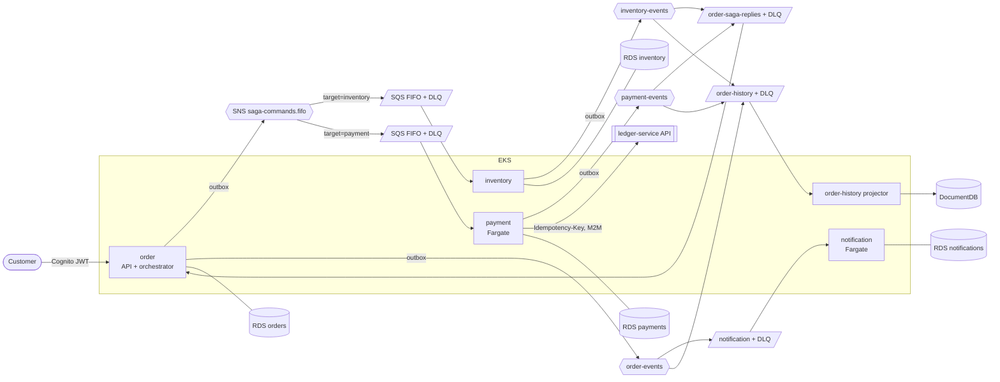

# order-saga-platform

Four microservices (**order, inventory, payment, notification**) that place an order across three databases and an external ledger with no distributed transaction. The design goals are **no lost orders, no double charges, no leaked stock**, even when messages are duplicated, delayed, reordered or poisoned and the ledger times out.

NestJS + TypeScript monorepo, designed for AWS: EKS (EC2 node group + Fargate), SNS/SQS, RDS PostgreSQL, DocumentDB, Cognito. Everything runs locally on Docker + LocalStack.

## Why this exists

| Problem | How it is handled | Where |
|---|---|---|
| A business transaction spans order, inventory, payment | **Orchestrated saga**: persisted state machine in the order service, deadlines per step, compensations (release stock, refund) | [ADR 0002](docs/adr/0002-orchestrated-saga.md), [saga-machine.ts](apps/order/src/saga/saga-machine.ts), [sequence diagrams](docs/sagas.md) |
| Event lost on crash, or announced for a rolled-back write | **Transactional outbox** in every producer, `SKIP LOCKED` relay that keeps per-order ordering | [ADR 0004](docs/adr/0004-outbox-and-inbox.md), [outbox.ts](libs/outbox/src/outbox.ts) |
| At-least-once delivery → duplicates | **Inbox** in every consumer (exactly-once *effect*), business keys, tombstones | [inbox.ts](libs/outbox/src/inbox.ts), [stock.service.ts](apps/inventory/src/stock/stock.service.ts) |
| A compensation overtaking the action it undoes | **SNS FIFO → SQS FIFO** for commands, `MessageGroupId = orderId` | [ADR 0003](docs/adr/0003-sns-sqs-messaging.md), [topology.ts](libs/messaging/src/topology.ts) |
| Poison messages blocking queues | Schema validation, visibility 0 → DLQ in seconds, alarms, bounded redrive tool | [sqs-consumer.ts](libs/messaging/src/sqs-consumer.ts), [redrive.ts](libs/messaging/src/redrive.ts) |
| Ledger slow/down; "did the charge happen?" | Per-attempt timeout, full-jitter retries, circuit breaker, deterministic `Idempotency-Key`; refunds resolve unknown charges by idempotent replay | [ledger-client.ts](apps/payment/src/ledger/ledger-client.ts), [payment.service.ts](apps/payment/src/payments/payment.service.ts) |
| "My orders" across three services | **CQRS read model** in DocumentDB (5.0-compatible subset only), rebuilt from an event archive | [ADR 0005](docs/adr/0005-documentdb-read-model.md), [projector](apps/order/src/history/order-history.projector.ts), [replay](apps/order/src/history/replay.ts) |
| Stale vs. fresh reads, how long to wait | Explicit consistency table and deadline budget | [ADR 0006](docs/adr/0006-consistency-and-latency.md) |
| Where each service runs | EC2 node group for the hot path, Fargate for isolation/spiky loads | [ADR 0007](docs/adr/0007-eks-compute-placement.md), [Helm values](deploy/helm/values) |
| Service boundaries | One Postgres database + role per service, no shared tables; one IAM role per service | [init.sql](docker/postgres/init.sql), [workloads.yaml](infra/workloads.yaml) |

## Architecture



More: [architecture (C4)](docs/architecture.md) · [saga paths](docs/sagas.md).

## Run locally

Requirements: Node 22, Docker. Host ports used: 3101-3105, 5433 (Postgres), 27018 (MongoDB), 4567 (LocalStack).

```bash
npm ci
docker compose up -d --build --wait   # Postgres 16, MongoDB 5.0, LocalStack (SNS/SQS),
                                      # topology provisioning, 4 services + ledger stub
```

Locally `AUTH_MODE=disabled`: any bearer token is accepted. `Bearer <customer>` is a customer, and `Bearer svc-*` is a service principal.

```bash
# catalogue + wallet (M2M endpoints)
curl -X PUT localhost:3102/internal/products/SKU-1 -H 'Authorization: Bearer svc-ops' \
  -H 'Content-Type: application/json' -d '{"name":"Mug","unitPrice":"1500","currency":"BRL","available":10}'
curl -X PUT localhost:3103/internal/wallets/alice -H 'Authorization: Bearer svc-ops' \
  -H 'Content-Type: application/json' -d '{"ledgerAccountId":"wallet-alice"}'

# place an order (202 Accepted, outcome decided by the saga)
curl -X POST localhost:3101/orders -H 'Authorization: Bearer alice' \
  -H 'Idempotency-Key: 7f9c2a51d0e8' -H 'Content-Type: application/json' \
  -d '{"items":[{"sku":"SKU-1","quantity":2}]}'

curl localhost:3101/orders/<orderId> -H 'Authorization: Bearer alice'           # write model
curl localhost:3101/orders/<orderId>/history -H 'Authorization: Bearer alice'   # read model + timeline
```

Operational tools (against the compose stack, see `.env.example`):

```bash
npm run projection:replay                          # rebuild the read model from the archive
npm run dlq:redrive -- payment-commands.fifo 10    # bounded DLQ redrive (FIFO-aware)
npm run e2e:latency -- 100                         # sequential orders, latency percentiles
```

## API

| Method | Path | Auth | Notes |
|---|---|---|---|
| `POST` | `/orders` | customer, `orders/write` | Requires `Idempotency-Key`; `202` + `Location`; replay returns `Idempotent-Replayed: true`; reused key with another body → `422` |
| `GET` | `/orders/:id` | customer (own orders), `orders/read` | Strongly consistent (Postgres): `status`, `sagaState`, `total`, `cancelReason` |
| `GET` | `/orders` | customer, `orders/read` | Read model, `X-Read-Model: eventually-consistent`, `?limit&before` |
| `GET` | `/orders/:id/history` | customer, `orders/read` | Read model: status + cross-service timeline |
| `GET` | `/internal/sagas/:orderId` | M2M `orders/admin` | Saga state + transition audit |
| `POST` | `/internal/sagas/:orderId/retry` | M2M `orders/admin` | Resume a `FAILED` compensation |
| `PUT`/`GET` | `/internal/products/:sku` | M2M `inventory/admin` | Catalogue and stock sync |
| `PUT` | `/internal/wallets/:customerId` | M2M `payment/admin` | Map a customer to a ledger wallet |
| `GET` | `/internal/payments/:orderId` | M2M `payment/admin` | Payment state |
| `GET` | `/health/live`, `/health/ready` | public | All services |

Errors are [RFC 9457 problem details](https://www.rfc-editor.org/rfc/rfc9457). Amounts are integer minor units as strings. Messages are documented as zod schemas in [`libs/contracts`](libs/contracts/src/messages.ts).

## Tests

```bash
npm test            # unit: 47 tests (state machine, consumer error handling, retry/breaker,
                    #       ledger client, auth guard, contracts, env, EMF)
npm run test:int    # integration: 11 tests, Testcontainers Postgres 16 + MongoDB 5.0 +
                    #       LocalStack 3.8, all four services in-process with real consumers
```

The integration suites run every saga path end to end:

- happy path;
- out of stock;
- payment declined → release;
- payment timeout with a charge that *did* happen → refund + release, net zero in the ledger.

They also cover duplicate command delivery and duplicate replies (applied once), a poison message reaching the DLQ in seconds while other orders keep flowing, bounded redrive, projection replay producing an identical read model, out-of-order projection, idempotent order creation, and public health probes.

Last local run (Windows 11, Docker Desktop, shared developer machine with other projects building concurrently): unit 47/47 passed, integration 11/11 passed in about 45 s including container start-up.

## Measured numbers

Environment: the same developer laptop, Docker Desktop, full `docker compose` stack (LocalStack 3.8 for SNS/SQS), default settings (`OUTBOX_POLL_INTERVAL_MS=200`, `SQS_WAIT_TIME_SECONDS=20`). Other projects were running on the machine at the same time. Command: `npm run e2e:latency -- 100` (100 sequential orders, 25 ms polling resolution).

| Metric | p50 | p95 | max |
|---|---|---|---|
| `POST /orders` → `CONFIRMED` (write model) | 594 ms | 715 ms | 889 ms |
| `POST /orders` → `CONFIRMED` visible in read model | 679 ms | 901 ms | 1092 ms |

The happy path crosses four relay hops, so most of the time is outbox polling (about half the poll interval per hop on average) plus LocalStack delivery. LocalStack is not AWS: these numbers are a baseline for comparing changes, not a production SLO. `npm run projection:replay` rebuilt 100 orders from 700 archived events in 1.4 s on the same machine.

No throughput or concurrency load test has been run yet.

## Deploy

- **CloudFormation** ([`infra/`](infra), validated with `cfn-lint`):
  - [`messaging.yaml`](infra/messaging.yaml): topics, FIFO and standard queues, DLQs with redrive-allow policies, filter policies, DLQ and backlog alarms.
  - [`data.yaml`](infra/data.yaml): RDS PostgreSQL 16 with per-service secrets, DocumentDB 5.0 with TLS and audit logs.
  - [`identity.yaml`](infra/identity.yaml): Cognito user pool, auth-code + PKCE web client, resource servers, operations M2M client.
  - [`workloads.yaml`](infra/workloads.yaml): Fargate profile and one least-privilege IRSA role per service.
- **Helm** ([`deploy/helm`](deploy/helm)): one chart, one values file per service (`compute: ec2|fargate`).
  - The chart creates a migration Job (pre-upgrade hook), HPA, PDB, a NetworkPolicy, probes and a hardened security context.
  - Fargate pods get an ADOT collector sidecar; EC2 pods use the node DaemonSet.
  - The read-model projector is its own release from the same image.
- **CI** ([`.github/workflows/ci.yml`](.github/workflows/ci.yml)): typecheck, lint, unit + coverage, build, Testcontainers integration, `cfn-lint`, `helm lint/template` for every service, multi-arch image build.

The EKS cluster, VPC and ingress are expected from the platform stack and are not defined here.

## Docs

- ADRs:
  - [0001 decision log and monorepo](docs/adr/0001-record-architecture-decisions.md)
  - [0002 orchestration vs choreography vs Step Functions](docs/adr/0002-orchestrated-saga.md)
  - [0003 SNS/SQS vs EventBridge vs MSK, FIFO, visibility](docs/adr/0003-sns-sqs-messaging.md)
  - [0004 outbox/inbox](docs/adr/0004-outbox-and-inbox.md)
  - [0005 DocumentDB read model](docs/adr/0005-documentdb-read-model.md)
  - [0006 consistency and latency](docs/adr/0006-consistency-and-latency.md)
  - [0007 EC2 vs Fargate](docs/adr/0007-eks-compute-placement.md)
- [Architecture](docs/architecture.md) · [Saga sequence diagrams](docs/sagas.md) · [Failure modes](docs/failure-modes.md) · [Runbook](docs/runbook.md) · [Threat model](docs/threat-model.md)

## Known gaps

- Notification has no sweeper for `PENDING` rows left by a crash between send and commit ([failure modes](docs/failure-modes.md)).
- DocumentDB compatibility is enforced by convention and review. Tests run against MongoDB 5.0, not DocumentDB.
- No load test yet; the numbers above are sequential latency only.

## License

MIT
