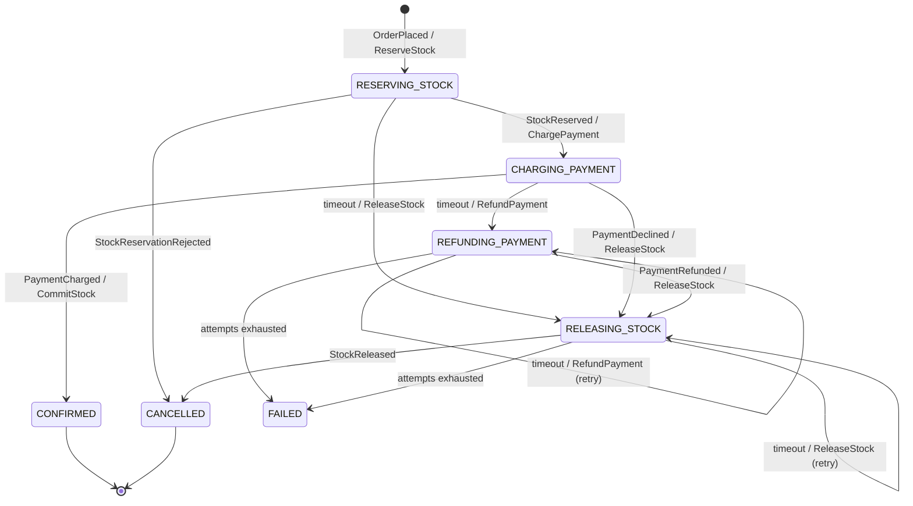

# 2. Orchestrated saga with a persisted state machine in the order service

- Status: Accepted
- Date: 2026-04-07

## Context

Placing an order touches three services that own their own data: order, inventory (stock) and payment (money, through the external ledger). There is no distributed transaction across their databases, so the business transaction is a saga:

1. create order → 2. reserve stock → 3. charge payment → 4. confirm

with compensations when a later step fails (release stock, refund payment) and timeouts when a participant does not answer.

Three ways to coordinate it were considered.

## Options

| | Choreography (events only) | Orchestration in the order service | AWS Step Functions |
|---|---|---|---|
| Where the flow lives | Spread across every participant's subscriptions | One state machine in `apps/order/src/saga` | ASL definition in AWS |
| Adding a step | Change several services + subscriptions | Change one transition table | Change the ASL + Lambda/SDK integrations |
| Timeouts | Each participant needs its own timer; "nobody answered" has no owner | Deadline column per saga, one scanner | Built in (`TimeoutSeconds`, `HeartbeatSeconds`) |
| Compensation ordering | Emerges from event reactions; hard to reason about | Explicit (`REFUNDING_PAYMENT` → `RELEASING_STOCK`) | Explicit (`Catch` + compensating states) |
| "What state is order X in?" | Reconstruct from logs of 3 services | `SELECT state FROM sagas` | `DescribeExecution` |
| Coupling | Participants know each other's events | Participants know only their commands; orchestrator knows everyone | Same as orchestration, plus AWS lock-in |
| Testability | Needs the whole system | Pure function, unit-tested exhaustively | Step Functions Local / LocalStack, slower feedback |
| Cost at 1M orders/month | Messages only | Messages + a few rows | Standard workflow ≈ 6 transitions/order → ~6M state transitions (~US$150/month at the public price per 1,000 transitions) plus the messages |
| Runs on EKS + LocalStack | Yes | Yes | Needs Lambda/activity workers or SDK integrations to reach EKS pods |

## Decision

**Orchestration, with the order service as orchestrator and an explicit, persisted state machine.**

- The saga state lives in the order database (`sagas` table: `state`, `version`, `deadline_at`, `attempts`, `cancel_reason`) next to the order it coordinates, so creating an order and starting its saga is one local transaction.
- Transitions are a **pure function** `transition(saga, input, now) → { next, commands, events }` (`apps/order/src/saga/saga-machine.ts`). Everything around it is plumbing: load with `FOR UPDATE`, apply, persist, write commands/events to the outbox in the same transaction.
- Every transition is appended to `saga_transitions` (audit trail, debugging stuck sagas).
- Each waiting state has a **deadline**. A scanner (`FOR UPDATE SKIP LOCKED`, safe with N replicas) feeds a `timeout` input into the same function.
- Forward-step timeouts trigger compensation; compensation-step timeouts **retry the compensation** with backoff. After `SAGA_MAX_COMPENSATION_ATTEMPTS` the saga goes to `FAILED` and pages a human (runbook: stuck sagas). Compensations must eventually succeed; giving up silently is not an option when money is involved.
- Participants are passive: they receive commands, act idempotently, and reply with events. They do not know the saga exists.

State machine:

## Why not Step Functions

Step Functions is the right tool when steps are Lambdas or AWS SDK calls. Here every participant is a long-running pod on EKS that already consumes SQS; the integration would be `.waitForTaskToken` with task tokens passed through our messages and `SendTaskSuccess` calls from each participant. That makes every participant aware of the orchestrator's runtime, adds IAM surface, and moves the state out of the database where the order lives (two sources of truth for "is this order confirmed?"). We would reconsider if the flow grows human approval steps or long waits (days), where Step Functions' durability and visual history pay off.

## Consequences

- One place to read the flow, one place to add a step, exhaustive unit tests of every transition.
- The order service is more important than the others: if it is down, sagas pause (they do not fail). Its outbox and deadline scanner resume them on restart.
- The orchestrator must tolerate duplicate and out-of-order replies. Replies that do not apply to the current state are recorded and ignored, never treated as errors.
- Inventory and payment must make their compensations idempotent and safe to receive *before* the action they compensate (tombstones; see ADR 0004).
