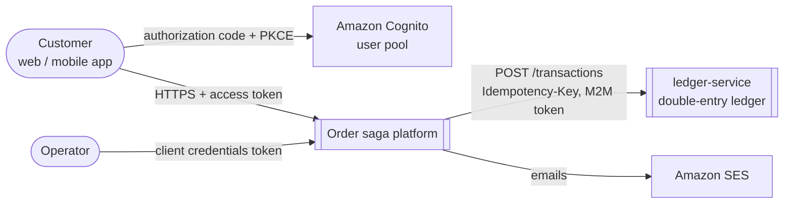
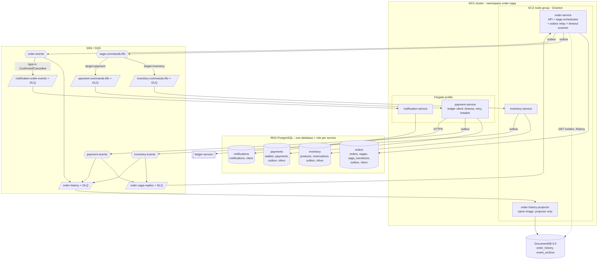

# Architecture

## System context (C4 level 1)



## Containers (C4 level 2)



## Code layout

```
apps/
  order/          API, saga (pure state machine + persistence), read model (Mongo), admin API
  inventory/      stock reservations (ordered row locks, tombstones)
  payment/        ledger client (resilience), charge/refund handlers, wallets
  notification/   notification intents + sender
  ledger-stub/    in-memory ledger-service contract for compose and tests
libs/
  contracts/      envelope + zod message catalogue (the only shared "API")
  messaging/      topology, SNS publisher, SQS consumer, provisioning, DLQ redrive
  outbox/         outbox (enqueue, relay) and inbox (processOnce)
  observability/  pino logger, EMF metrics, health probes
  tracing/        OpenTelemetry bootstrap (imported first)
  platform/       env parsing, Kysely + migrations, auth guard/verifiers, M2M tokens, workers
  resilience/     retry with full jitter, circuit breaker
tools/            provision, migrate, dlq-redrive, e2e-latency
infra/            CloudFormation: messaging, data, identity, workloads
deploy/helm/      one chart, values per service
```

Rules enforced by lint: libs never import apps; apps never import each other. The only thing services share is `libs/contracts`.

## Observability

- **Logs:** pino JSON with `service`, HTTP `reqId` (propagated `x-request-id`) and, inside message handlers, `correlationId` (= order id), `messageType` and `eventId` from AsyncLocalStorage. `grep <orderId>` across all services reconstructs a saga.
- **Traces:** OpenTelemetry auto-instrumentation (HTTP, Express, pg, AWS SDK, MongoDB). Trace context is stored with each outbox row and sent as SNS message attributes; consumers continue the trace, so one trace spans API → orchestrator → participants.
- **Metrics (CloudWatch EMF):** `SagaTransition{To}`, `MessagesConsumed{Outcome=processed|retry|poison}`, `PaymentCharged`, `PaymentDeclined{Reason}`, `PaymentRefunded`, `LedgerCircuitTransition{To}`; SQS `ApproximateAgeOfOldestMessage` and DLQ depth alarms from CloudFormation.
- **Probes:** `/health/live` (process only), `/health/ready` (Postgres, plus DocumentDB for order; flips to 503 on shutdown before workers stop).
