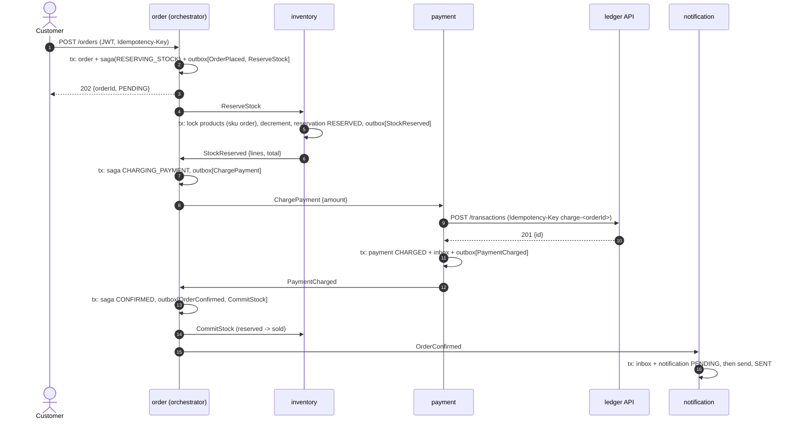
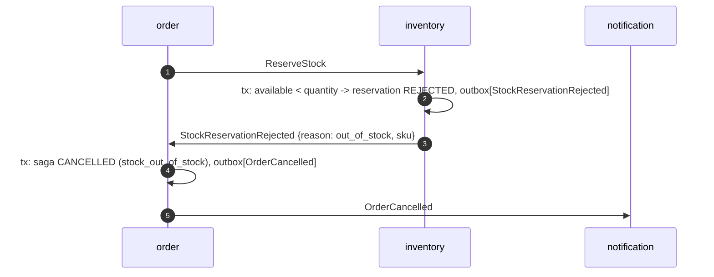
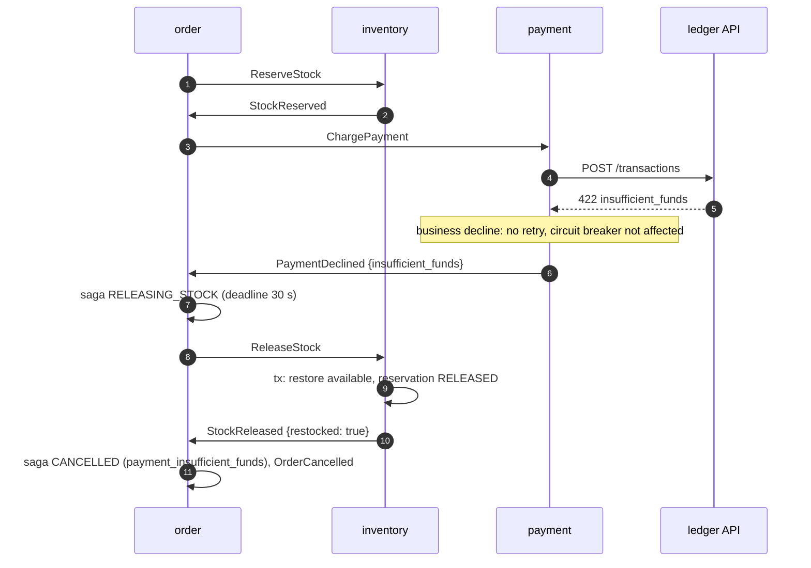
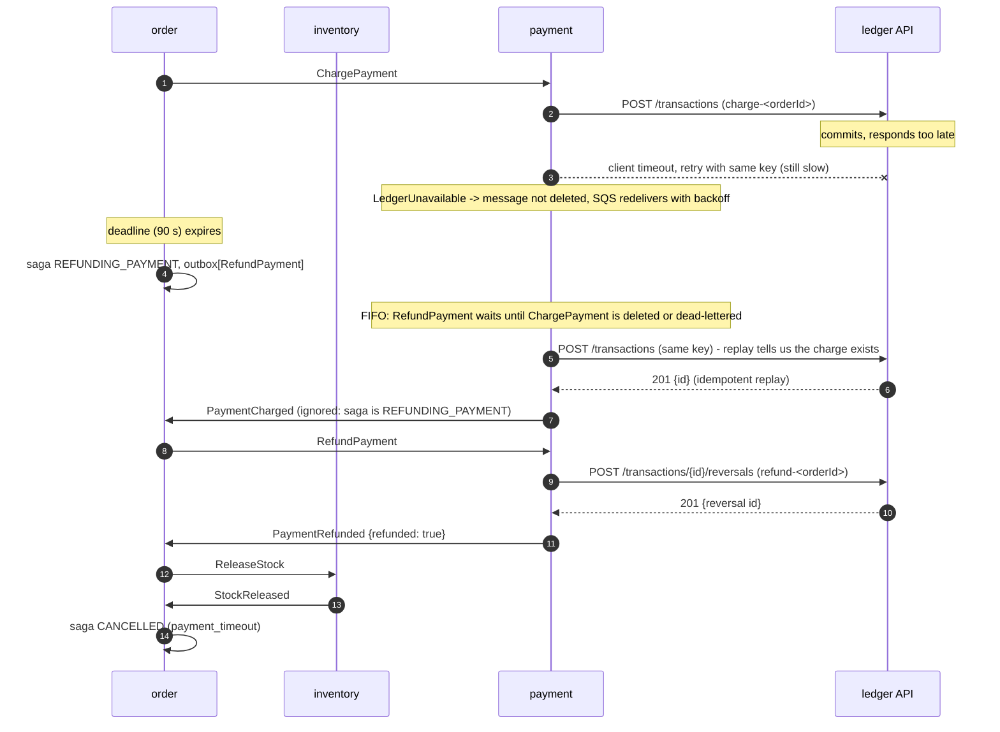
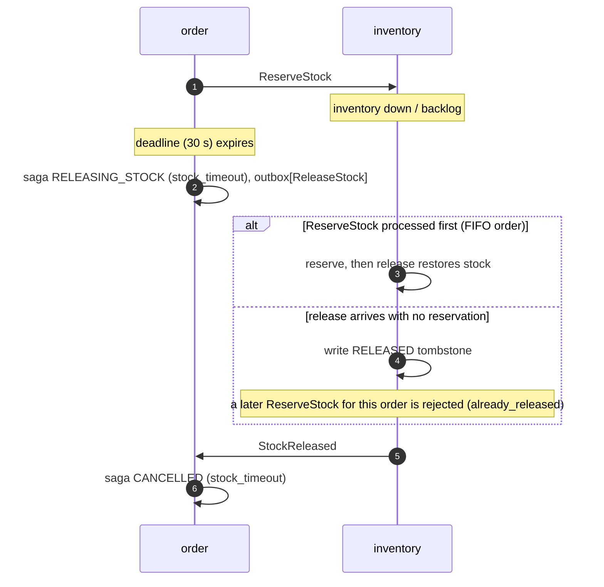
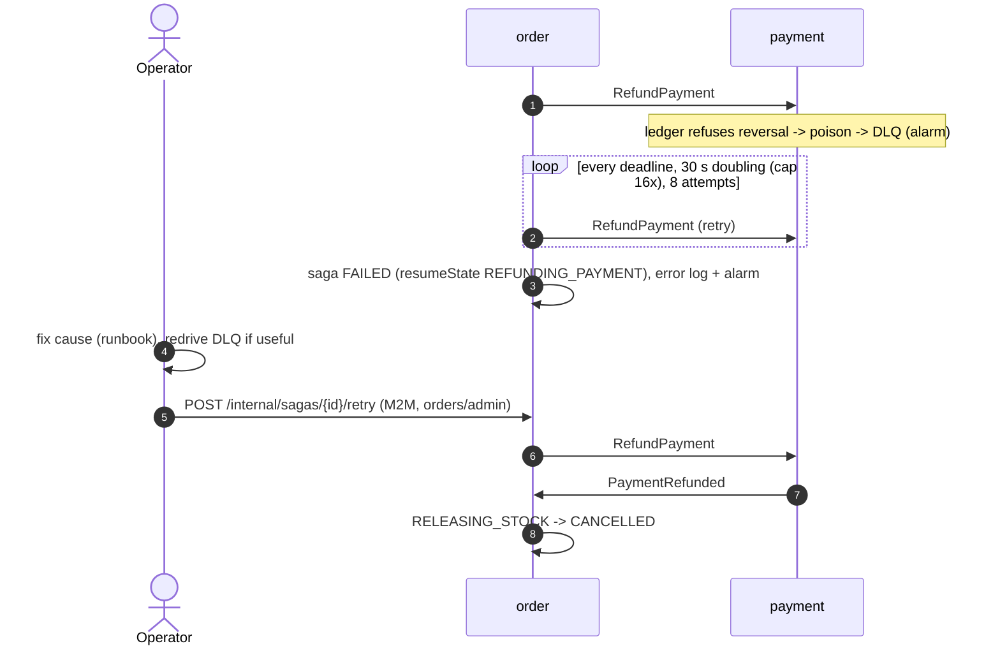

# Saga paths

Sequence diagrams for every path of the order saga. Every arrow between services is
`outbox → SNS → SQS → inbox` (ADR 0004). The diagrams show the message, not that plumbing.
Commands travel on `saga-commands.fifo` (one FIFO group per order); replies on
`inventory-events` / `payment-events`.

State machine: [ADR 0002](adr/0002-orchestrated-saga.md). Integration tests that run each
path against real Postgres, MongoDB and LocalStack: [`test/saga.int-spec.ts`](../test/saga.int-spec.ts).

## 1. Happy path

## 2. Out of stock (no compensation needed)

## 3. Payment declined → release stock

## 4. Payment timeout → refund (resolving an unknown charge) → release stock

The ledger committed the charge but answered after the client timeout. Payment never
learned the outcome, and the order's `CHARGING_PAYMENT` deadline expired.

If the charge had **not** reached the ledger, the refund's replay would post it and then
immediately reverse it (net zero, both visible in the ledger). If the ledger declines the
replay, the refund answers `refunded: false`.

## 5. Reservation timeout → release (tombstone)

## 6. Compensation keeps failing → FAILED → operator retry

